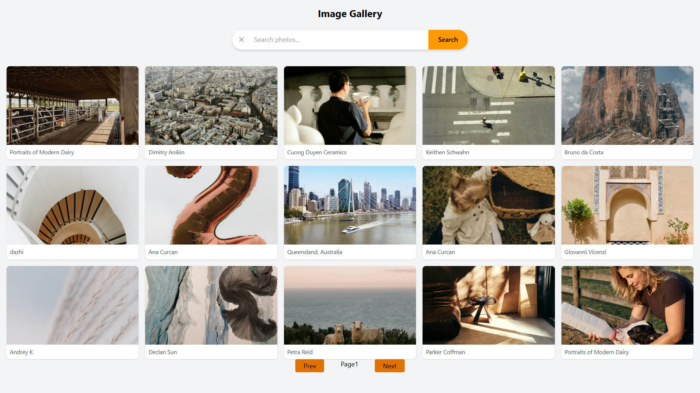
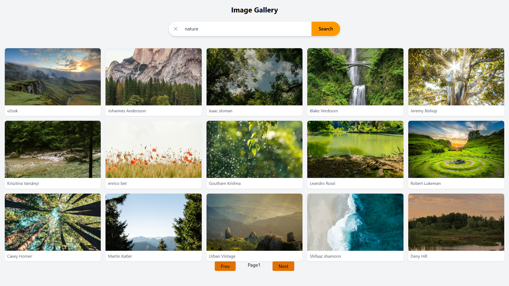
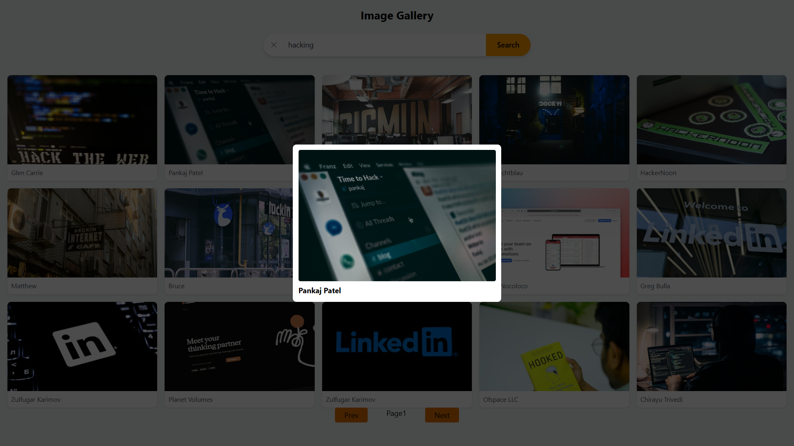

# React Image Gallery

A responsive image gallery built with **React** and the **Unsplash API**. Browse photos, search for images using keywords, navigate through pages, and view photos in a larger preview.

## Screenshots

### 1. Main Gallery



### 2. Search Results



### 3. Pagination


### 4. Selected Image Preview



## Features

- Browse photos from Unsplash.
- Search photos using keywords.
- Paginate through photo results.
- View larger images using a photo preview modal.
- Clear search and return to the normal gallery.
- Responsive image grid.

## Tech Stack

- React.js
- JavaScript
- Tailwind CSS
- Axios
- Unsplash API
- Vite

## Getting Started

### 1. Clone the repository

```bash
git clone https://github.com/kamble-chetan/react-image-gallery.git
```

### 2. Navigate to the project directory

```bash
cd react-image-gallery
```

### 3. Install dependencies

```bash
npm install
```

### 4. Configure the Unsplash API

Create a `.env` file in the root directory:

```env
VITE_UNSPLASH_KEY=your_unsplash_access_key
```

Replace the placeholder with your own Unsplash Access Key.

### 5. Start the development server

```bash
npm run dev
```

Open the local URL displayed in your terminal.

## Project Structure

```text
image-gallery/
├── public/
├── screenshots/
│   ├── main-gallery.png
│   ├── search-results.png
│   ├── pagination.png
│   └── image-modal.png
├── src/
│   ├── App.jsx
│   ├── main.jsx
│   └── ...
├── .env.example
├── .gitignore
├── Package.json
├── package-lock.json
└── README.md
```

## Future Improvements

- Photo orientation filtering.
- Loading and error states.
- Improved search experience.
- Better UI and user interactions.
- Refactoring into reusable React components.

## API

Photos are provided through the [Unsplash API](https://unsplash.com/developers).

## Author

**Chetan Kamble**

[GitHub Profile](https://github.com/kamble-chetan)

⭐ Thanks for visiting my project!
